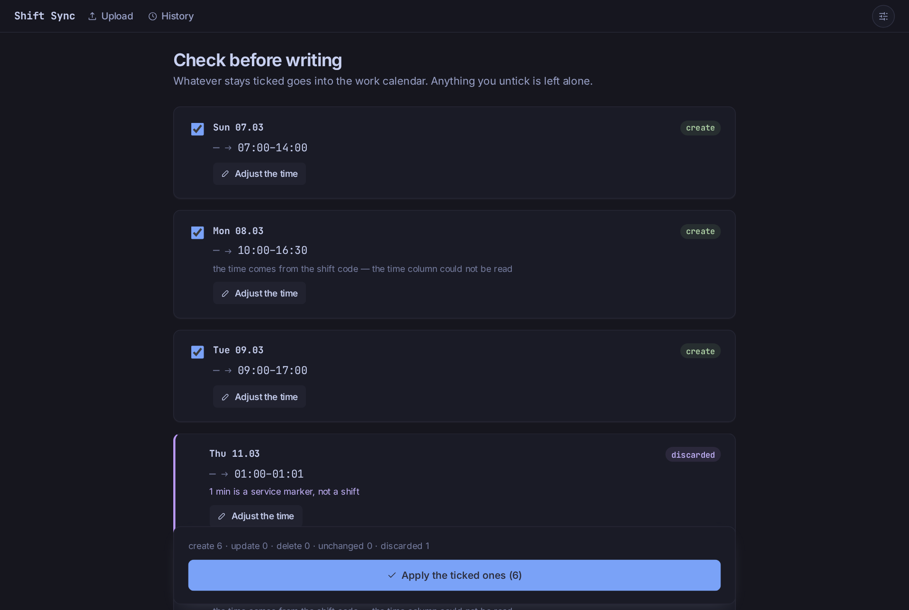
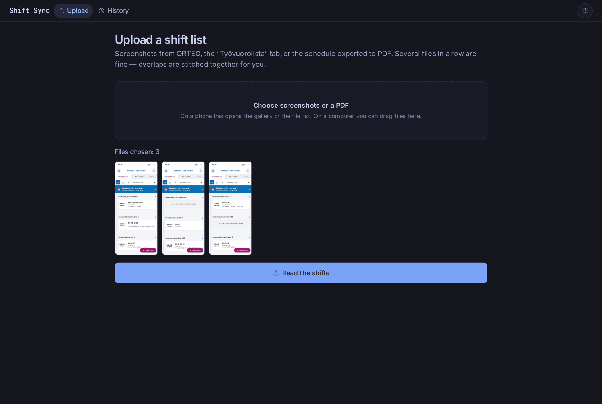
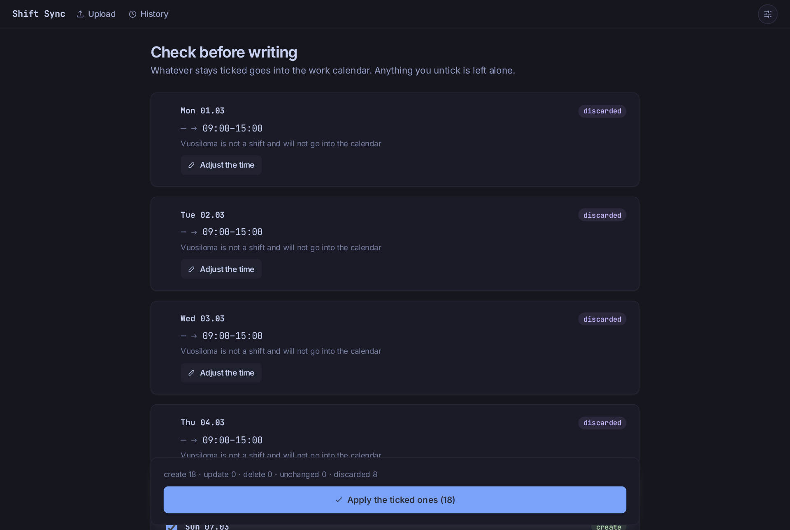
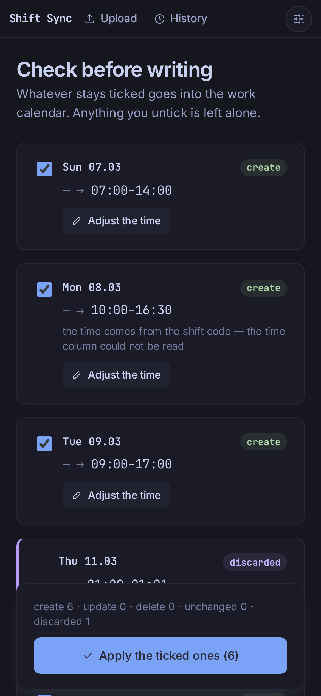
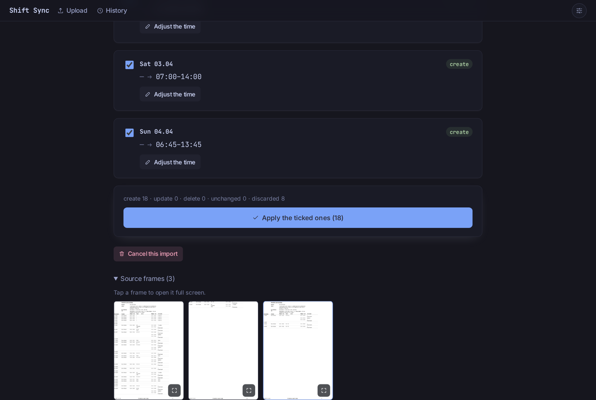
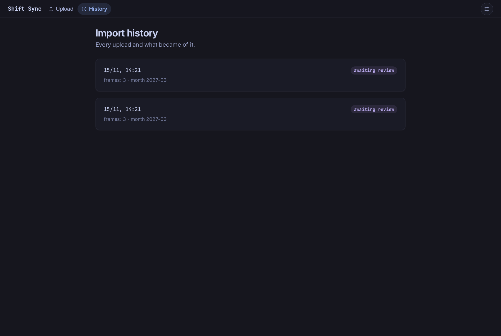

# Shift Sync

**English** · [Русский](README.ru.md)

A self-hosted service that reads a work schedule from **ORTEC Employee Self Service** —
as phone screenshots or as the PDF export — and syncs the shifts into a Google Calendar
after a person has checked them.

The schedule app only lives on a phone, and copying a month of shifts into a family
calendar by hand is exactly the kind of chore that goes wrong quietly. Shift Sync turns it
into: take three screenshots, upload, glance at the plan, press *Apply the ticked ones*. Recognition runs
locally, nothing leaves the machine except the calendar write, and it costs nothing to run.

> Not affiliated with ORTEC or Google. The service parses what the ESS app and its PDF
> report show; if their layout changes, the parser has to follow.



<sub>All screenshots and samples use a made-up schedule — the person, the store and every
shift are invented (<a href="tools/samples/schedule.mjs">tools/samples/schedule.mjs</a>).
No real person's data.</sub>

## What it does

- **Reads screenshots** of the ESS «Työvuorolista» tab with a local OCR model (PP-OCRv5).
  Several overlapping frames are fine — days are stitched together by date.
- **Reads the PDF export** directly from its text layer, without OCR: exact text with
  coordinates, a whole month in ~50 ms.
- **Shows a plan before writing anything**: *create / update / delete / unchanged /
  discarded*, with "before → after" times and the reason for every doubtful row. Doubtful
  rows are unticked by default; the time can be corrected right in the row.
- **Writes only what is ticked** into one Google Calendar, through a service account that
  can see that one calendar and nothing else.
- **Keeps history** of every import with its source frames, and can cleanly undo
  everything it created (`purge`).

## Engineering notes

The interesting part is not the OCR itself but making a cheap OCR trustworthy.

- **Three independent sources for every shift.** On a screenshot the same shift is written
  three times: the time column (`07:00 / 14:00`), the card title (`410 7-14`) and the
  duration line (`Vuoroaika: 7 h`). A deterministic gate cross-checks them together with
  the weekday printed next to the date. Anything that doesn't agree goes to review instead
  of the calendar — the model is never trusted on its own.
- **A closed vocabulary.** All the "hard" text on the screen is numbers plus 19 Finnish
  words (weekdays and months). Fuzzy matching against that list (Levenshtein ≤ 2) pulls
  `syvskuuta` and `syyskuufa` back to `syyskuuta`.
- **Box salvage.** The detector sometimes finds a text box that the batch recognition pass
  returns empty; such boxes are re-recognised one by one. On the original screenshots this
  turned 8/9 into 9/9.
- **The PDF is not OCR'd at all.** Columns are found from the header row, not hard-coded;
  cells that wrap mid-word (`410 ` + `Tupakka/k` + `assa`) are glued back thanks to
  whitespace-preserving extraction; the page footer is cut off so it doesn't leak into the
  last shift.
- **Things the report says that must not be taken literally.** A shift code like `410 7-14`
  is a template name, not the time (the shift may be 06:45–13:45). Vacation days carry a
  time too. Days after the "published until" date are empty because the plan is still a
  draft — treating them as days off would delete future shifts. Each of these has its own
  rule and test.
- **Safe calendar writes.** Every event carries a private extended property, and the
  service only ever lists events by that tag, so it cannot see or touch anything else in a
  shared calendar. An import only touches dates present in the uploaded files.
- **Synthetic test data.** Real schedules never enter the repository. Tests, the OCR bench
  and these screenshots run on generated samples that reproduce the real layouts
  (`samples/`); one's own real files can sit in an ignored `private/` folder, and a
  regression test picks them up automatically when present.

## Stack

| | |
|---|---|
| Backend | NestJS 11, MikroORM 6, PostgreSQL 17, Zod-validated config, pino |
| Recognition | PP-OCRv5 latin mobile via `ppu-paddle-ocr` + onnxruntime (CPU); `mupdf` for PDF text and page rendering |
| Frontend | Nuxt 4 SPA, served by the backend; English and Russian, light and dark themes, mobile-first |
| Calendar | Google Calendar API with a service account (`calendar.events` scope only) |
| Tooling | pnpm workspaces, Turborepo, Vitest, Playwright, Docker Compose |

## Screenshots

| Upload | PDF import review | On a phone |
|---|---|---|
|  |  |  |

| Source pages of a PDF import | Import history |
|---|---|
|  |  |

## Getting started

Requirements: Node 22, pnpm 10, Docker.

```bash
pnpm install
cp .env.example .env              # set APP_PASSWORD and SESSION_SECRET
docker compose up -d --build      # http://localhost:4080, migrations run on start
```

Log in with `APP_PASSWORD` and upload the samples from `samples/ess/` (screenshots) or
`samples/pdf/` (PDF reports) to see the whole flow. Without Google configured everything
works except *Apply the ticked ones*, which refuses with a clear message and writes nothing.

Development, with hot reload:

```bash
pnpm db:up                        # PostgreSQL on port 5481
pnpm --filter @fc/contracts build
pnpm --filter @fc/api dev         # backend on 4080
pnpm --filter @fc/web dev         # frontend on 4081, proxied to the backend
```

### Connecting Google Calendar

Create a service account in Google Cloud with only the Calendar API enabled, put its JSON
key into `secrets/service-account.json`, share the target calendar with the account's
address with *"Make changes to events"*, and set `GCAL_CALENDAR_ID` in `.env`. Then check
that the account can reach that calendar and nothing else:

```bash
pnpm --filter @fc/api run check:google
```

No OAuth consent screen is involved: an app in *Testing* status gets its refresh token
revoked every 7 days, a service account doesn't. Step-by-step guide: `docs/SETUP.md`,
section 4.

### Undoing what it created

```bash
pnpm --filter @fc/api run purge -- --all              # dry run: what would be removed
pnpm --filter @fc/api run purge -- --from=2027-03-01 --to=2027-03-31 --yes
```

## Tests

```bash
pnpm --filter @fc/api test        # parsers, gates, diff, retries, DB + calendar writes
pnpm --filter @fc/contracts test  # both UI dictionaries: keys, placeholders
pnpm bench                        # OCR quality bench: 9/9 days on the synthetic frames
pnpm scan:test                    # the secret scanner checks itself
```

The integration tests use a separate `fc_shift_sync_test` database on the same server.
Regenerating the samples: `pnpm samples` (see `samples/README.md`).

## Documentation

The design documents are in Russian:

- [`docs/SETUP.md`](docs/SETUP.md) — installation, configuration, Google setup, phone access
- [`docs/HOW-IT-WORKS.md`](docs/HOW-IT-WORKS.md) — screens, processes, code map
- [`docs/shift-sync-architecture.md`](docs/shift-sync-architecture.md) — architecture and the reasoning behind it
- [`docs/DECISIONS.md`](docs/DECISIONS.md) — decision log

## Privacy and security

- OCR runs locally; the only outbound calls are to the Google Calendar API and a one-time
  download of the OCR weights. Fonts are bundled.
- One user, one password. Expose it to the internet only behind HTTPS
  (`COOKIE_SECURE=true`).
- The service account can write events to one calendar and nothing else: no project
  roles, no domain-wide delegation, a single shared calendar.
- `.env`, `secrets/`, uploaded frames (`storage/`) and real samples (`private/`) are
  git-ignored. A pre-commit hook runs a scanner for keys, tokens, e-mail addresses and
  machine paths; enable it once per clone:

  ```bash
  git config core.hooksPath .githooks
  ```

  Personal identifiers (names, employer, calendar IDs) go into a local, ignored
  `.scan-local.json` — `{"identifiers": ["…"]}` — and the scanner checks for them too.

## Limitations

- Shifts never cross midnight in the schedule this was built for, and the model assumes so.
- The parsers follow the current ESS app and report layout. A change there shows up in the
  OCR bench on the first run.
- Single user by design.
