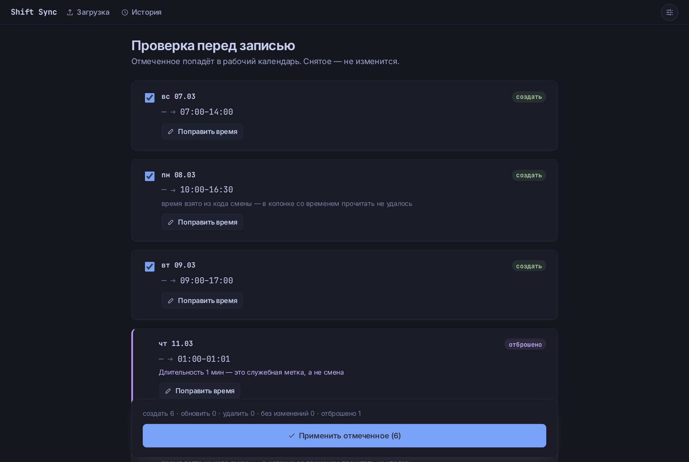
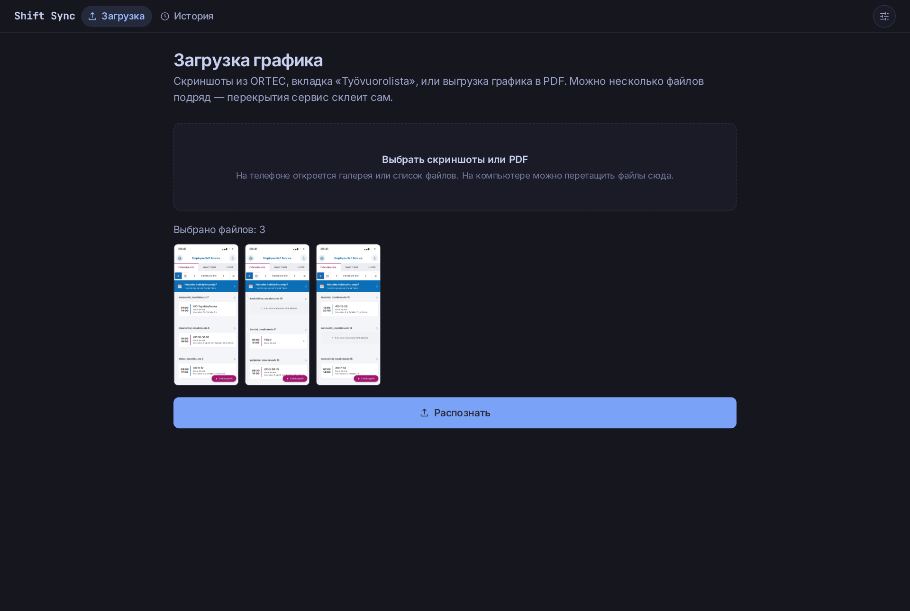
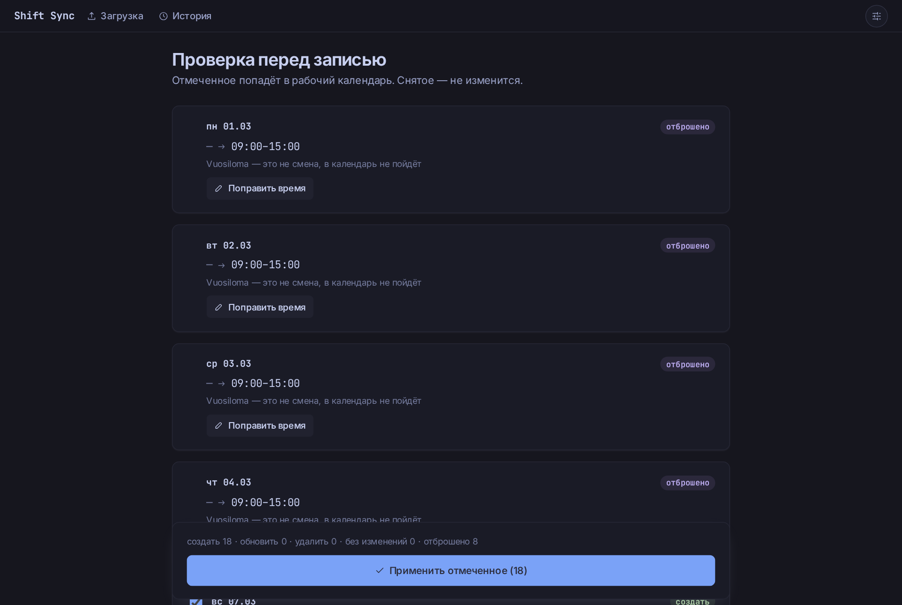
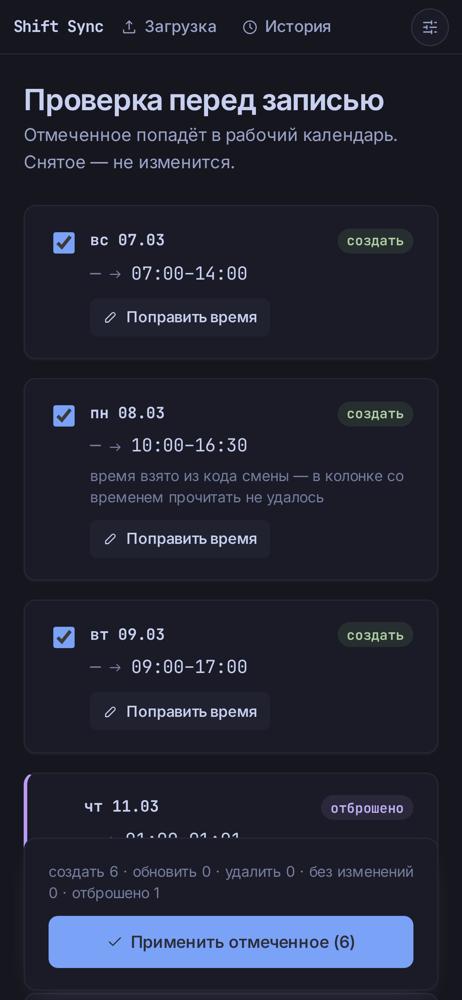
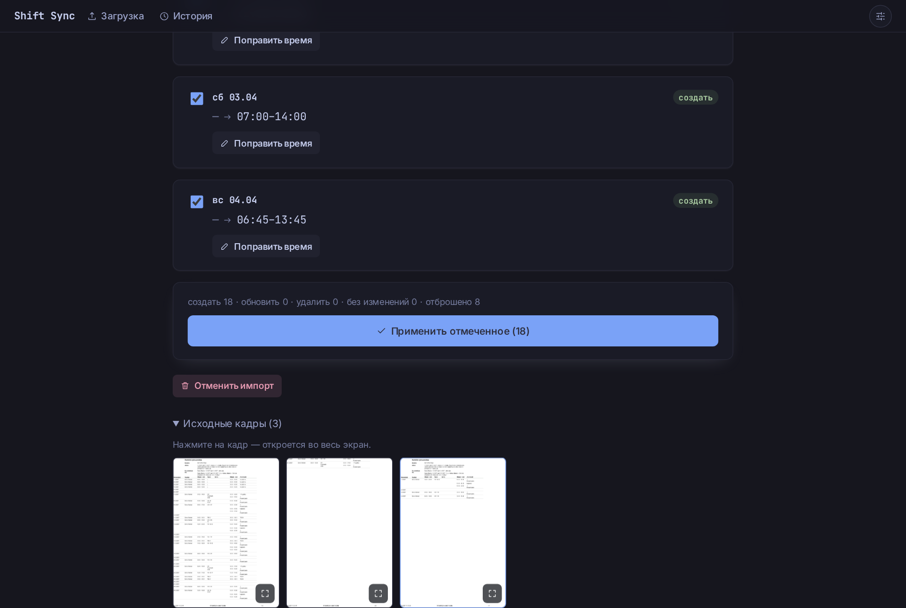
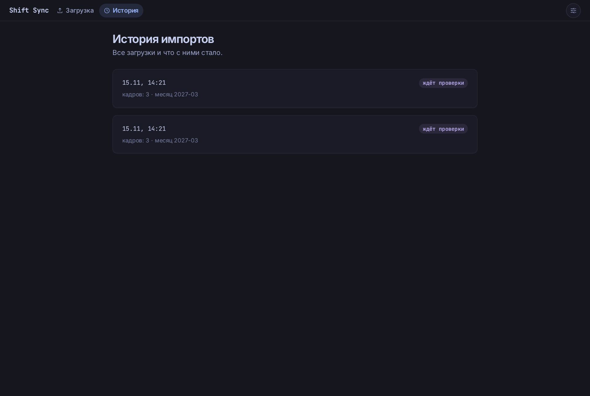

# Shift Sync

[English](README.md) · **Русский**

Сервис для своего сервера: читает рабочий график из **ORTEC Employee Self Service** —
снимками экрана телефона или выгрузкой в PDF — и после проверки человеком записывает смены
в Google Календарь.

График живёт только в приложении на телефоне, а переписывать месяц смен в семейный
календарь руками — ровно та рутина, в которой ошибки случаются незаметно. С Shift Sync это
выглядит так: три скриншота, загрузить, взглянуть на план, нажать «Применить отмеченное». Распознавание
локальное, наружу не уходит ничего, кроме записи в календарь, работает бесплатно.

> Проект не связан с ORTEC и Google. Сервис разбирает то, что показывают приложение ESS и
> его PDF-отчёт; если их вёрстка изменится, парсер придётся поправить.



<sub>Все снимки экрана и образцы — на выдуманном графике: человек, магазин и смены не
существуют (<a href="tools/samples/schedule.mjs">tools/samples/schedule.mjs</a>).
Реальных данных нет.</sub>

## Что умеет

- **Читает скриншоты** вкладки «Työvuorolista» локальной моделью OCR (PP-OCRv5). Можно
  несколько кадров с перекрытием — дни склеиваются по датам.
- **Читает выгрузку в PDF** прямо из текстового слоя, без OCR: точный текст с координатами,
  месяц целиком за ~50 мс.
- **Показывает план до записи**: создать / обновить / удалить / без изменений / отброшено,
  время «было → станет» и причину для каждой спорной строки. Спорные строки по умолчанию
  не отмечены, время можно поправить прямо в строке.
- **Записывает только отмеченное** в один Google Календарь — через сервисный аккаунт,
  которому виден этот календарь и больше ничего.
- **Хранит историю** импортов вместе с исходными кадрами и умеет начисто убрать всё, что
  создал (`purge`).

## Инженерные решения

Интересна не сама модель OCR, а то, как сделать дешёвому OCR можно доверять.

- **Три независимых источника для каждой смены.** На скриншоте одна смена записана трижды:
  колонка времени (`07:00 / 14:00`), заголовок карточки (`410 7-14`) и строка
  длительности (`Vuoroaika: 7 h`). Детерминированный шлюз сверяет их между собой и с днём
  недели рядом с датой. Всё, что не сошлось, уходит в ревью, а не в календарь: модели на
  слово не верим.
- **Закрытый словарь.** Весь «сложный» текст на экране — числа и 19 финских слов (дни недели
  и месяцы). Нечёткое сравнение с этим списком (Левенштейн ≤ 2) возвращает `syvskuuta` и
  `syyskuufa` к `syyskuuta`.
- **Добор потерянных боксов.** Детектор иногда находит бокс текста, а пакетное
  распознавание возвращает для него пустоту; такие боксы распознаются поодиночке. На
  исходных скриншотах это превратило 8/9 в 9/9.
- **PDF не распознаётся вообще.** Колонки находятся по строке заголовка, а не зашиты
  числами; ячейки, порванные посреди слова (`410 ` + `Tupakka/k` + `assa`), собираются
  обратно благодаря чтению с сохранением пробелов; подпись внизу страницы отсекается, чтобы
  не уехать в последнюю смену.
- **Чему в отчёте нельзя верить буквально.** Код смены `410 7-14` — имя шаблона, а не время
  (смена может идти 06:45–13:45). У дней отпуска тоже есть время. Дни после даты публикации
  пусты, потому что график ещё черновик, — считать их выходными значит стереть будущие
  смены. На каждый случай — своё правило и свой тест.
- **Безопасная запись в календарь.** Каждое событие несёт приватное свойство, и сервис
  выбирает события только по этой метке, поэтому ничего другого в общем календаре не видит и
  не трогает. Импорт меняет только даты, которые есть в загруженных файлах.
- **Синтетические данные для тестов.** Настоящий график в репозиторий не попадает. Тесты,
  стенд OCR и эти скриншоты работают на сгенерированных образцах, повторяющих настоящую
  вёрстку (`samples/`); свои реальные файлы можно держать в игнорируемой папке `private/`,
  и регрессионный тест подхватит их сам.

## Стек

| | |
|---|---|
| Backend | NestJS 11, MikroORM 6, PostgreSQL 17, конфигурация с проверкой через Zod, pino |
| Распознавание | PP-OCRv5 latin mobile через `ppu-paddle-ocr` + onnxruntime (CPU); `mupdf` — текст и отрисовка PDF |
| Frontend | Nuxt 4 SPA, раздаётся самим backend; русский и английский, светлая и тёмная темы, сначала под телефон |
| Календарь | Google Calendar API через сервисный аккаунт (только `calendar.events`) |
| Инструменты | pnpm workspaces, Turborepo, Vitest, Playwright, Docker Compose |

## Снимки экрана

| Загрузка | Проверка импорта из PDF | На телефоне |
|---|---|---|
|  |  |  |

| Исходные страницы PDF | История импортов |
|---|---|
|  |  |

## Запуск

Нужны Node 22, pnpm 10, Docker.

```bash
pnpm install
cp .env.example .env              # заполнить APP_PASSWORD и SESSION_SECRET
docker compose up -d --build      # http://localhost:4080, миграции применятся сами
```

Войти паролем из `APP_PASSWORD` и загрузить образцы из `samples/ess/` (скриншоты) или
`samples/pdf/` (выгрузки), чтобы увидеть весь путь. Без Google работает всё, кроме кнопки
«Применить отмеченное»: она откажет с понятным сообщением и ничего не запишет.

Разработка, с перезагрузкой на лету:

```bash
pnpm db:up                        # PostgreSQL на порту 5481
pnpm --filter @fc/contracts build
pnpm --filter @fc/api dev         # backend на 4080
pnpm --filter @fc/web dev         # фронт на 4081 с прокси на backend
```

### Подключение Google Календаря

Создать в Google Cloud сервисный аккаунт с одним включённым Calendar API, положить его
JSON-ключ в `secrets/service-account.json`, открыть на адрес аккаунта нужный календарь с
правом «Внесение изменений в мероприятия» и указать `GCAL_CALENDAR_ID` в `.env`. Затем
проверить, что аккаунту доступен этот календарь и больше ничего:

```bash
pnpm --filter @fc/api run check:google
```

Экран согласия OAuth не нужен: у приложения в статусе *Testing* Google отзывает
refresh-токен каждые 7 дней, у сервисного аккаунта такого нет. Пошагово — `docs/SETUP.md`,
раздел 4.

### Убрать созданное

```bash
pnpm --filter @fc/api run purge -- --all              # сухой прогон: что удалится
pnpm --filter @fc/api run purge -- --from=2027-03-01 --to=2027-03-31 --yes
```

## Тесты

```bash
pnpm --filter @fc/api test        # парсеры, шлюзы, дифф, повторы, запись в БД и календарь
pnpm --filter @fc/contracts test  # словари интерфейса: ключи, подстановки
pnpm bench                        # стенд качества OCR: 9 из 9 дней на синтетических кадрах
pnpm scan:test                    # проверка сканера секретов
```

Интеграционные тесты работают с отдельной базой `fc_shift_sync_test` на том же сервере.
Пересобрать образцы: `pnpm samples` (подробнее — `samples/README.md`).

## Документация

- [`docs/SETUP.md`](docs/SETUP.md) — установка, конфигурация, подключение Google, доступ с телефона
- [`docs/HOW-IT-WORKS.md`](docs/HOW-IT-WORKS.md) — экраны, процессы, карта кода
- [`docs/shift-sync-architecture.md`](docs/shift-sync-architecture.md) — архитектура и обоснования
- [`docs/DECISIONS.md`](docs/DECISIONS.md) — журнал решений

## Приватность и безопасность

- OCR работает локально; наружу уходят только запросы к Google Calendar API и однократная
  загрузка весов модели. Шрифты лежат в самом проекте.
- Один пользователь, один пароль. Выставлять в интернет — только за HTTPS
  (`COOKIE_SECURE=true`).
- Сервисный аккаунт может писать события в один календарь и больше ничего: без ролей в
  проекте, без делегирования на домен, расшарен ровно один календарь.
- `.env`, `secrets/`, загруженные кадры (`storage/`) и реальные образцы (`private/`) — в
  `.gitignore`. Хук перед коммитом запускает сканер ключей, токенов, адресов почты и путей
  машины; включается один раз на клон:

  ```bash
  git config core.hooksPath .githooks
  ```

  Свои опознаватели (имена, работодатель, ID календарей) — в локальном игнорируемом
  `.scan-local.json` вида `{"identifiers": ["…"]}`; сканер ищет и их.

## Ограничения

- Смены не пересекают полночь — так устроен график, под который сервис писался.
- Парсеры следуют текущей вёрстке приложения ESS и отчёта. Изменение там стенд OCR
  покажет первым же прогоном.
- Сервис рассчитан на одного пользователя.
