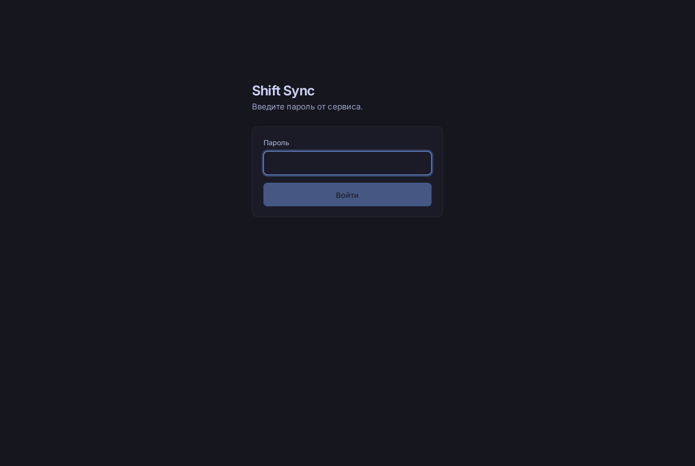
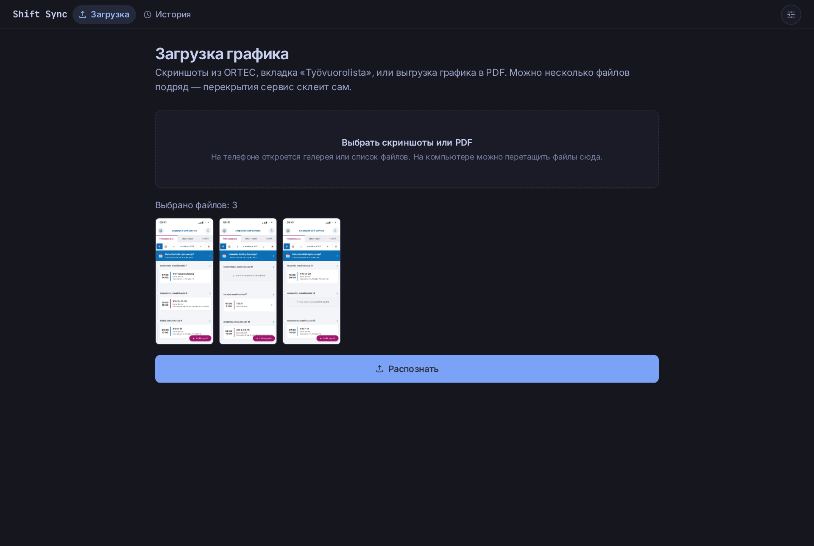
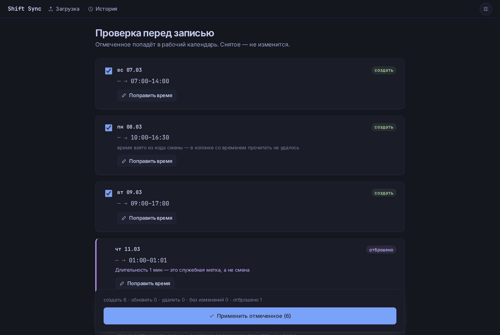
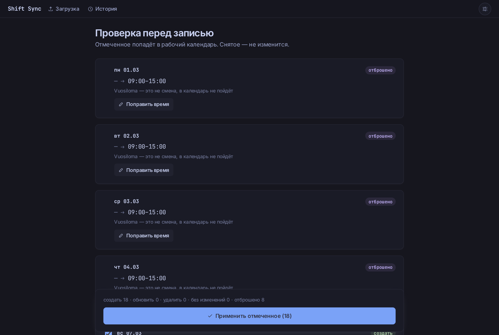
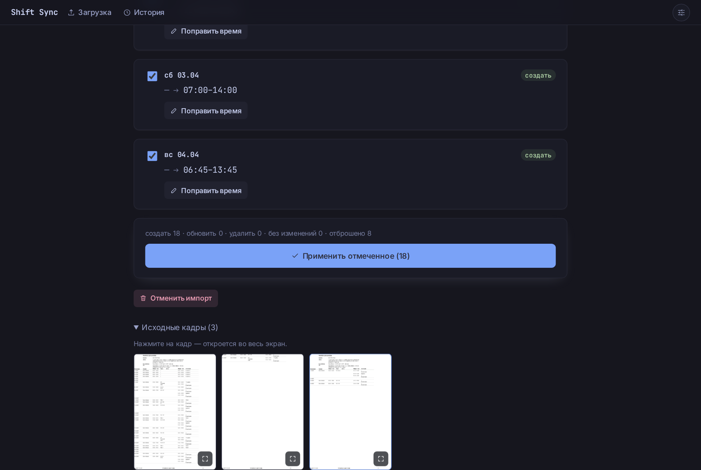
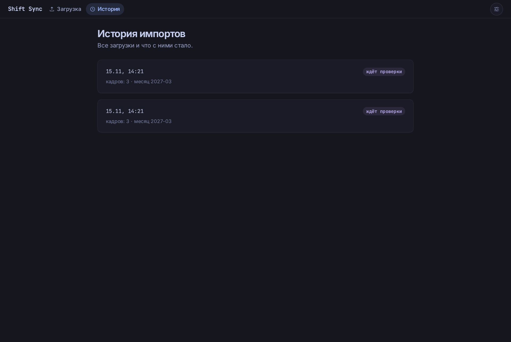
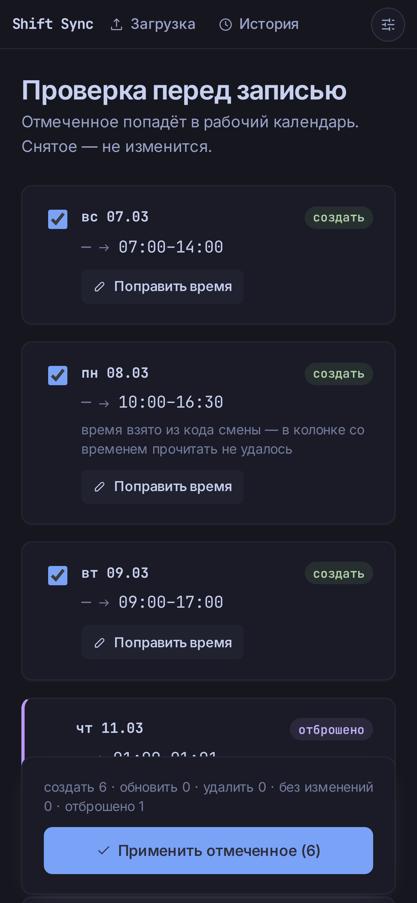

# Shift Sync — как всё устроено

Описание построенного сервиса: экраны, процессы, устройство кода.
Обоснование решений — в `shift-sync-architecture.md`, развилки реализации — в `DECISIONS.md`.

**Дата:** 7 сентября 2026 · **Статус:** работает

---

## 1. Что получилось

Сервис принимает рабочий график из ORTEC Employee Self Service — **снимками экрана или
выгрузкой в PDF**, — разбирает смены локально и после подтверждения человеком записывает их
в Google Календарь.

| | |
|---|---|
| Снимки экрана | PP-OCRv5 локально, **9 дней из 9** — и на реальных кадрах, и на синтетических из `samples/ess/`, ~104 мс на кадр |
| Выгрузка PDF | текстовый слой напрямую, без распознавания: все дни реальных выгрузок и синтетических `samples/pdf/`, 53 мс на документ |
| Тесты | **87** зелёных: словарь, оба парсера, оба шлюза, дифф, повторы, ошибки, запись в БД |
| Экраны | 4, мобильные в первую очередь |
| Внешние зависимости | Google Calendar API; веса OCR качаются один раз |
| Стоимость | 0 ₽ |

Оба формата ведут в один и тот же конвейер: расходятся только чтение файла и шлюз проверок,
дальше — общая склейка, общий план изменений, общий экран проверки и общая запись в календарь.
Файлы можно смешивать в одной загрузке.

---

## 2. Экраны

Все снимки — тёмная тема, на синтетических образцах из `samples/` (выдуманный график);
английские версии лежат рядом, `docs/screenshots/en-*.png`.

### Вход



Одно поле. Пароль из `APP_PASSWORD`, сравнение через `timingSafeEqual` по хешам
фиксированной длины — длина пароля тоже утечка. Сессия в HttpOnly-cookie на 30 дней,
пять попыток за 15 минут.

### Загрузка

На телефоне открывается галерея или список файлов, на компьютере файлы можно перетащить.
Несколько файлов подряд — норма: перекрытия склеиваются по датам.

Принимаются снимки экрана (JPEG, PNG, WebP) и выгрузка графика в PDF. У PDF превью до
загрузки нет — страницы отрисовываются на сервере и дальше показываются такими же кадрами,
как скриншоты.



### Проверка перед записью



Главный экран. По каждой дате видно «было → станет» и что именно будет сделано.
Спорные строки подсвечены и **не отмечены** по умолчанию — их надо осознанно включить
или поправить время кнопкой «Поправить время».

Внизу липкая панель со сводкой и кнопкой применения.



Так выглядит проверка выгрузки PDF: отпуск и `TES V` отброшены с пояснением, новые смены
отмечены и ждут подтверждения. Даты, которые уже стоят в календаре с тем же временем,
помечаются «без изменений» и не отмечены.



Страницы PDF показываются там же, где снимки экрана, и открываются во весь экран тем же
просмотром. Экран проверки не знает, чем загрузили.

### История



Все загрузки и что с ними стало.

### Переключатель темы

Кнопка в шапке циклически переключает **«Как в системе» → «Светлая» → «Тёмная»**.
Выбор сохраняется в браузере (`localStorage`, ключ `fc:theme`) и переживает
перезагрузку, действует во всех вкладках.

Три состояния, а не два: «как в системе» — разумное значение по умолчанию,
телефон сам переходит в тёмную вечером. Явный выбор перебивает систему в обе стороны.

Тема выставляется встроенным скриптом в `<head>` **до первой отрисовки** — иначе
у выбравших тёмную страница успевала бы моргнуть светлой.

Значки нарисованы SVG, а не набраны символами `☀ ☾ ◐`: этих глифов может не
оказаться в шрифтах системы, и кнопка покажет пустой квадрат. Поймано при съёмке
скриншотов — headless-браузер отрисовал ровно такой квадрат.



---

## 3. Процессы

### П1. Загрузка и распознавание

```
ТЕЛЕФОН                    API                          ФОНОВЫЙ ВОРКЕР
   │
   │ POST /api/imports (multipart)
   ├──────────────────────►│
   │                       │ создаёт батч, статус pending
   │                       │ считает sha256, сохраняет кадры
   │                       │ PDF узнаёт по байтам `%PDF-` и рисует
   │                       │   его страницы в кадры, оригинал хранит
   │                       │ дубликаты внутри пачки отбрасывает
   │◄──────────────────────┤ отвечает id сразу
   │   { id, status }      │
   │                       └── запускает распознавание ──►│
   │                                                      │ статус recognizing
   │ GET /api/imports/:id                                 │
   ├──────────────────────►│                              │ PP-OCRv5 + добор боксов
   │   { status: recognizing }                            │ парсер вёрстки ORTEC
   │                       │                              │ закрытый словарь
   │ …опрос раз в 1,2 с    │                              │ шлюз из 5 проверок
   │                       │                              │ пишет recognized_rows
   │                       │                              │ статус review
   │ GET /api/imports/:id  │◄─────────────────────────────┘
   ├──────────────────────►│
   │   { status: review, rows, plan }
   │◄──────────────────────┤
```

**Почему в фоне.** Три кадра — около секунды. Держать HTTP-запрос открытым незачем,
а таймаут на медленном мобильном соединении оставил бы батч в подвешенном состоянии.

**Почему опрос, а не WebSocket.** Один пользователь, один батч раз в две недели.
Опрос раз в 1,2 секунды на пару секунд — это дешевле, чем поддерживать соединение.

**Единица разбора у PDF — документ, а не страница.** Граница публикации написана в шапке
первой страницы, а строки дней продолжаются на следующих, где шапки таблицы уже нет.

### Чему в выгрузке нельзя верить буквально

**Код смены не гарантирует времени.** День бывает помечен шаблоном `410 7-14`, а работа
идёт **06:45–13:45** (в образце — 4 апреля 2027). Код — имя шаблона, а не расписание, поэтому в проверке он не участвует:
время берётся из колонки `Alkaen - Asti`, а сверяется со строками активностей, из которых
смена состоит. Из кода время берётся только тогда, когда колонка пуста, и это подписано в ревью.

**Отпуск выглядит как смена.** `Vuosiloma` занимает ту же строку таблицы и имеет время
`09.00 - 15.00` — так отпускной день засчитывается в баланс часов. Без отдельного решения
в календаре появилось бы четыре события «Работа 09:00–15:00» на дни, когда человек в отпуске.
Такие строки опознаются по названию активности и в календарь не идут.

**Пустой день не всегда выходной.** В шапке написано, до какой даты график опубликован, и там же
предупреждение: «Shifts in schedules with status plan are not shown». День за этой границей
выглядит пустым потому, что расписание ещё черновик. Правило «пустой день = смены нет = удалить
событие» на нём снесло бы из календаря уже записанные будущие смены, поэтому дни за границей
не трогаются вовсе.

### П2. Ревью и правка

План изменений **не хранится** — он считается на лету при каждом запросе детали батча.
Так после ручной правки строки он всегда свежий, и не бывает ситуации, когда показанное
расходится с тем, что применится.

```
PATCH /api/imports/:id/rows/:rowId  { startsAt, endsAt, kind }
   │
   ├─ статус батча обязан быть review, иначе 400
   ├─ строка помечается editedByUser
   ├─ проверки пересчитываются: остаётся только «начало < окончания»
   │  (сверка с источниками OCR отменяется — правка их замещает)
   └─ возвращается весь батч с пересчитанным планом
```

### П3. Применение в календарь

```
POST /api/imports/:id/apply  { workDates: [...] }
   │
   ├─ ПРОВЕРКИ ДО ЗАПИСИ ───────────────────────────────────┐
   │   статус == review?          нет → 400                 │  ничего
   │   Google настроен?           нет → 400                 │  не записано
   │   выбрана хоть одна дата?    нет → 400                 │
   ├────────────────────────────────────────────────────────┘
   │
   ├─ статус applying
   │
   ├─ для каждой записи плана, чья дата подтверждена:
   │
   │    create │ 1. смена в БД (sync_state=pending), flush
   │           │ 2. Google.events.insert  ← с повторами
   │           │ 3. sync_state=synced, сохраняем event_id
   │           │    при сбое → sync_state=failed + текст ошибки, идём дальше
   │
   │    update │ 1. правим смену в БД, flush
   │           │ 2. Google.events.update по сохранённому event_id
   │           │    если события не было — insert
   │
   │    delete │ 1. Google.events.delete (404 и 410 = уже нет, не ошибка)
   │           │ 2. удаляем смену из БД
   │
   │    skip_identical / skip_invalid — пропускаем
   │
   ├─ на каждое действие пишется строка в sync_log
   │
   └─ применилось хоть что-то?  да → applied
                                нет → обратно в review, можно повторить
```

**Порядок «сначала база, потом календарь» выбран сознательно.** База — источник правды,
календарь её проекция. Если запись в Google упала, смена остаётся в базе с отметкой
`failed` и её можно повторить, не перезапуская распознавание. Обратный порядок оставил бы
события в календаре без следа в базе, и сверка считала бы их чужими.

**Ошибка на одной дате не останавливает остальные.** Каждая запись плана применяется
независимо, отчёт возвращается по всем.

### П4. Сверка с календарём

```
POST /api/gcal/reconcile
   │
   ├─ окно ±60 дней от сегодня
   ├─ выборка своих событий: privateExtendedProperty = app=fc-shift-sync
   ├─ сравнение с таблицей shifts
   └─ отчёт о расхождениях:
        missing_in_calendar  — в базе есть, в календаре нет (удалили руками)
        time_drift           — время разошлось (поправили руками в Google)
        orphan_in_calendar   — событие есть, записи в базе нет
```

Сверка только читает и сообщает. Что делать с расхождением, решает человек.

### П5. Вход и сессия

```
POST /api/auth/login { password }
   │
   ├─ throttler: 5 попыток / 15 минут / IP
   ├─ sha256(введённый) vs sha256(APP_PASSWORD), timingSafeEqual
   ├─ JWT подписывается SESSION_SECRET
   └─ HttpOnly + SameSite=Lax cookie на 30 дней

Глобальный AuthGuard закрывает всё, кроме /api/auth/login и /health.
```

---

## 4. Как сервис отличает свои события от чужих

Каждое созданное событие помечается приватным свойством:

```json
{
  "extendedProperties": {
    "private": {
      "app": "fc-shift-sync",
      "workDate": "2027-03-15",
      "fingerprint": "2027-03-15T07:00/14:00"
    }
  }
}
```

Выборка идёт **строго** по этой метке. Личные события владельца календаря сервис
не видит и тронуть не может — это то, что делает безопасной запись в общий календарь.

Время передаётся локальное плюс `timeZone: Europe/Helsinki`, а не UTC: тогда переход
на зимнее время Google обрабатывает сам.

---

## 5. Карта кода

```
apps/api/src/
├── common/
│   ├── retry.util.ts           повторы: экспонента + полный джиттер
│   ├── error-patterns.ts       перевод доменных ошибок в HTTP-статусы
│   ├── spa.middleware.ts       раздача собранного фронта
│   └── time.util.ts            даты и время без часовых поясов
├── config/                     валидация окружения через zod
├── database/
│   ├── entities/               5 сущностей MikroORM
│   ├── migrations/             генерируются из сущностей, руками не пишутся
│   └── mikro-orm.config.ts
└── modules/
    ├── auth/                   пароль, JWT в cookie, глобальный guard
    ├── recognition/            ← ядро
    │   ├── ocr.service.ts              PP-OCRv5 + добор потерянных боксов
    │   ├── pdf.service.ts              mupdf: текст с координатами и отрисовка страниц
    │   ├── parsers/
    │   │   ├── ortec-ess.parser.ts     вёрстка экрана приложения
    │   │   └── ortec-pdf.parser.ts     таблица выгрузки: колонки из шапки
    │   ├── vocabulary/
    │   │   ├── finnish.ts              закрытый словарь, Левенштейн
    │   │   └── ortec-activities.ts     что означает отсутствие, а не смену
    │   ├── validation/
    │   │   ├── validation-gate.ts      шлюз для снимков: 5 проверок
    │   │   └── pdf-gate.ts             шлюз для PDF: смена против своих активностей
    │   └── recognition.service.ts      оркестрация: снимки моделью, PDF текстом
    ├── imports/                загрузка, хранение, фоновый воркер, ревью
    ├── shifts/
    │   ├── diff.ts                 склейка кадров и план изменений
    │   ├── apply.process.ts        запись в БД и календарь
    │   └── reconcile.process.ts    сверка
    ├── gcal/                   клиент Google, метки, повторы
    └── health/

apps/web/app/
├── composables/                useApi, useAuth
├── middleware/auth.global.ts   всё закрыто, кроме логина
└── pages/                      login, index, imports/[id], history
```

---

## 6. Модель данных

```
import_batches ──1:N──► screenshots ──1:N──► recognized_rows
      │                                            ▲
      │                                            │
      ├────────────────1:N──────────────────────────┘
      │
      ├──1:N──► shifts        (source_batch_id, on delete set null)
      └──1:N──► sync_log      (batch_id, on delete set null)
```

| Таблица | Роль |
|---|---|
| `import_batches` | одна загрузка и её статус |
| `screenshots` | кадры, `sha256` для дедупликации; `source_kind` отличает страницу PDF от снимка, `source_path` ведёт к исходной выгрузке |
| `recognized_rows` | результат разбора блока дня + результат каждой проверки шлюза |
| `shifts` | **целевое состояние**: что должно быть в календаре |
| `sync_log` | журнал: что, когда и почему сделали с календарём |

Страницы PDF лежат в той же таблице `screenshots`, что и снимки экрана: `source_kind` отличает
одно от другого, `source_path` ведёт к исходной выгрузке, `page_index` — номер страницы. Оригинал
хранится потому, что разбор идёт по тексту, а текста в картинке нет: без файла импорт нельзя было
бы разобрать заново.

Даты хранятся как `varchar(10)` в формате `YYYY-MM-DD`, время — `varchar(5)` как `HH:MM`.
Это сознательный выбор (D-006): драйвер `pg` превращает `DATE` в JS-объект в локальной зоне
процесса, что даёт сдвиги на сутки, а ISO-строки сравниваются и сортируются идентично датам.

---

## 7. Устойчивость

### Повторы

Через `retry.util.ts` идут **все** вызовы Google и загрузка весов OCR.

| | |
|---|---|
| Схема | экспонента с полным джиттером: пауза равномерна на `[0, cap]` |
| По умолчанию | 4 попытки, база 400 мс, потолок 8 с |
| Повторяем | сетевые коды, `408 425 429 500 502 503 504` |
| Не повторяем | `400 401 404` и `403`, если это «нет прав», а не квота |

Джиттер не украшение: без него параллельные повторы синхронизируются и бьют по сервису
одной волной ровно тогда, когда он и так нездоров.

### Обработка ошибок

Конвенция: процессы бросают доменные `Error`,
контроллеры переводят их в HTTP через `processHttpError`. Каждый публичный метод процесса
обёрнут в try/catch, который пишет в журнал с контекстом и **пробрасывает дальше** —
глотать ошибку нельзя, вызывающий решит, что всё прошло.

### Что происходит при сбоях

| Сбой | Поведение |
|---|---|
| Google недоступен при применении | смена остаётся в БД с `sync_state=failed` и текстом ошибки; остальные даты применяются; импорт возвращается в `review` для повтора |
| Google не настроен | отказ **до** любой записи, база остаётся чистой |
| Распознавание упало | статус `failed` с текстом; сохранение статуса — во вложенном try/catch, иначе батч завис бы в «распознаётся» навсегда |
| Сеть отвалилась при загрузке весов | 3 попытки; закешированное обещание сбрасывается, иначе один сбой при старте отключил бы распознавание до перезапуска |
| Событие уже удалено в Google | `404` и `410` при удалении не считаются ошибкой |
| Кадры противоречат друг другу | в календарь не идёт, показывается в ревью с указанием обоих вариантов |

---

## 8. Что проверено

| Проверка | Результат |
|---|---|
| Словарь, парсер, шлюз на сохранённой выдаче OCR синтетических кадров | 19 тестов |
| Разбор PDF, шлюз, граница публикации, план — на синтетических выгрузках с геометрией настоящего отчёта | 22 теста |
| Правила диффа из постановки | 13 тестов |
| Повторы и различение временных ошибок | 10 тестов |
| Перевод доменных ошибок в HTTP | 8 тестов |
| Запись в БД и календарь (настоящая база, подставной Google) | 6 тестов |
| Словари обоих языков: ключи, подстановки, непереведённое | 9 тестов |
| Свои реальные образцы из `private/`, если они есть (иначе пропускаются) | 5 тестов |
| Стенд качества распознавания | 9 из 9 |
| Сквозной прогон в Docker-контейнере | оба формата, тот же результат |

```bash
pnpm --filter @fc/api test    # 78 тестов + 5 на своих образцах, если они есть
pnpm --filter @fc/contracts test   # 9 тестов, словари
pnpm bench                    # стенд распознавания
```

**Сквозной прогон PDF.** Две настоящие выгрузки (месяц и несколько дней следующего) загружены
в работающий контейнер: все строки разобраны, ни одной «требует внимания»; применение записало
события в календарь без ошибок, включая день, где время смены расходится с кодом шаблона.
После проверки записанное удалено, календарь и база возвращены в исходное состояние.

---

## 9. Эксплуатация

### Запуск

```bash
docker compose up -d --build     # всё вместе, миграции применятся сами
```

Или в разработке:

```bash
pnpm db:up
pnpm build && node apps/api/dist/main.js    # один процесс, http://localhost:4080
```

### Диагностика

| Симптом | Куда смотреть |
|---|---|
| Батч завис в «распознаётся» | логи `RecognitionService` и `OcrService`; при сбое статус должен стать `failed` |
| «Применить» отказывает | `GCAL_CALENDAR_ID` и наличие `secrets/service-account.json` |
| События не появляются в календаре | календарь открыт на адрес сервисного аккаунта с правом «Внесение изменений»? |
| В календаре лишнее или не хватает | `POST /api/gcal/reconcile` покажет расхождения |
| Что именно сделал сервис | таблица `sync_log`, строка на каждое действие |

### Что осталось сделать человеку

Создать сервисный аккаунт в Google Cloud, положить ключ в `secrets/service-account.json`,
указать `GCAL_CALENDAR_ID`. Пошагово — в корневом `README.md`.
